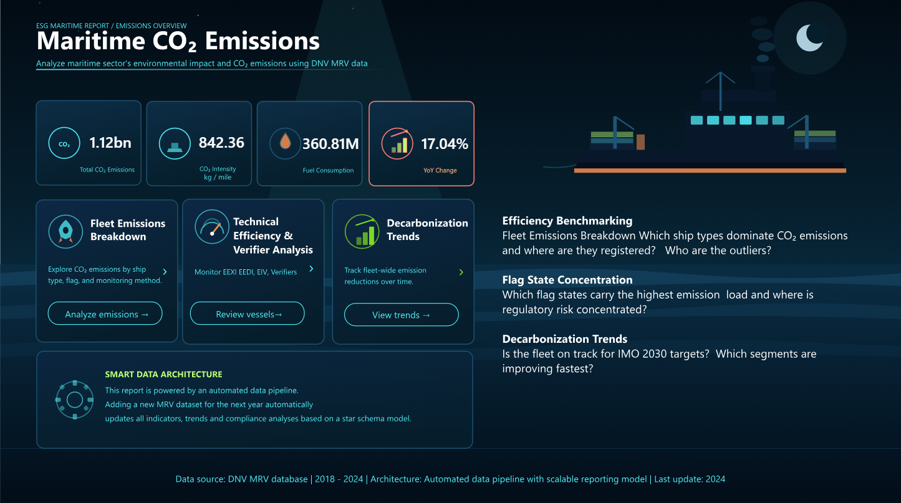
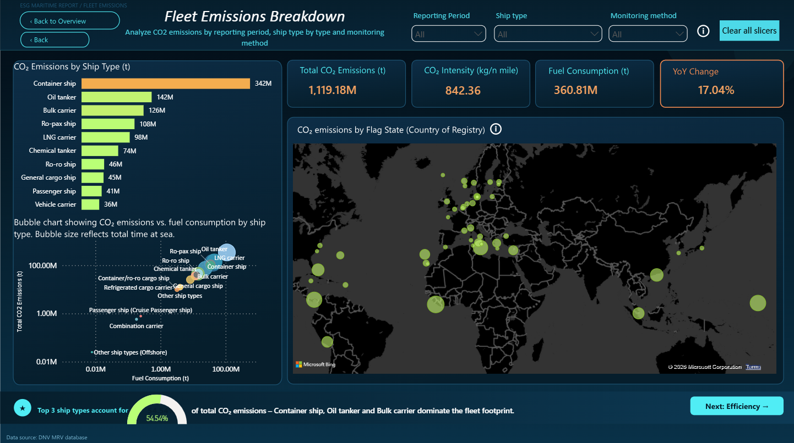
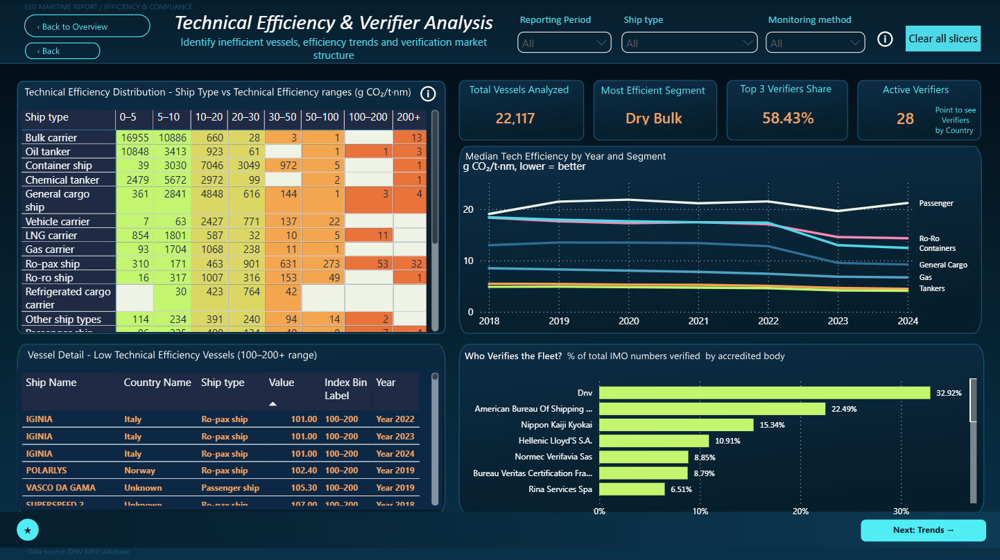
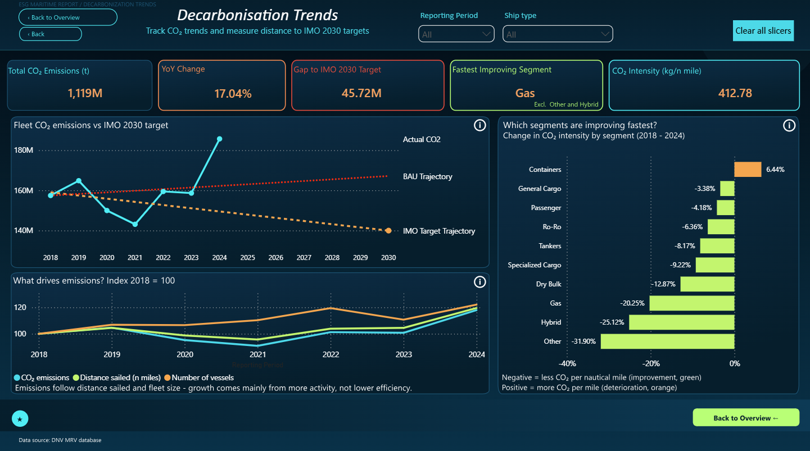

# Maritime CO₂ Emissions: ESG Report (Power BI)

Interactive Power BI report on CO₂ emissions, fuel consumption and technical efficiency of ships reporting under the EU MRV scheme, 2018-2024.

*Click the badge or the image to open the interactive report.*

**Data:** EU MRV public data (EMSA THETIS-MRV), 2018-2024
**Tools:** Power BI Desktop, Power Query, DAX
**Model:** star schema, new MRV files refresh all pages automatically

## Business questions

1. Which ship types dominate CO₂ emissions and who are the outliers?
2. Which flag states carry the highest emission load?
3. Is the fleet on track for the IMO 2030 target and which segments are improving fastest?

## 1. Fleet Emissions Breakdown

**Visuals:** KPI cards, CO₂ by ship type, CO₂ vs fuel consumption (log scale), CO₂ by flag state on a map, top 3 ship types banner.

**Insights**
- Container ships emit the most (342M t), followed by oil tankers (142M t) and bulk carriers (126M t).
- The top 3 ship types produce 54.5% of total CO₂.
- Emissions are concentrated under open registries such as Liberia, the Marshall Islands and Panama. The flag shows where a ship is registered, not where it emits.

## 2. Technical Efficiency & Verifier Analysis

**Visuals:** efficiency distribution by ship type and range, vessels above 100 g CO₂/t·nm, median efficiency trend by segment, verifier market share, KPI cards.

**Insights**
- About 97% of records are below 30 g CO₂/t·nm. Dry bulk is the most efficient segment.
- Efficiency changes slowly because it reflects ship design. The drop for containers and ro-ro ships in 2023 coincides with the introduction of EEXI.
- DNV, ABS and ClassNK verify about 70% of IMO numbers. 28 verifiers are active.

**Indicators** (g CO₂ per tonne-nautical mile, lower is better): EEDI for ships built from 2013, EEXI for existing ships from 2023, EIV as a simplified estimate for older ships.

## 3. Decarbonisation Trends

**Visuals:** emissions vs IMO 2030 target and business as usual, change in CO₂ intensity by segment, emission drivers indexed to 2018 = 100, KPI cards.

**Insights**
- Emissions dropped in 2020-2021 (COVID-19) and rose again from 2022. In 2024 they were 17% higher than in 2023.
- The fleet is above the target path. The gap to the 2030 target (about 140M t) is about 46M t.
- Growth comes from higher activity: compared to 2018, emissions rose about 18%, distance sailed about 19% and the number of vessels about 22%. Red Sea diversions may contribute in 2024.
- Most segments reduced CO₂ per nautical mile since 2018. Containers are the only segment with an increase (+6%).

## Methodology

- **IMO target:** at least 20% lower total emissions by 2030 compared to 2008 (IMO 2023 GHG Strategy).
- **2008 baseline:** MRV data starts in 2018, so 2008 is estimated assuming 2018 ≈ 90% of 2008 (Fourth IMO GHG Study).
- **Business as usual:** +0.5% per year from 2018.
- **Distance sailed:** total CO₂ divided by CO₂ per nautical mile.
- **CO₂ intensity by segment:** weighted (total CO₂ / total distance), not a simple average.

## Limitations

- The 2008 baseline is an estimate based on global shipping data.
- EEDI, EEXI and EIV use different methods, so efficiency values are approximate.
- Efficiency values are shown as reported. Values above 100 g CO₂/t·nm may be small vessels or reporting errors.
- "Other" and "Hybrid" are mixed segments, so their trends should be read with caution.
- In MRV, CO₂ is calculated from fuel consumption, so the two are closely linked.
